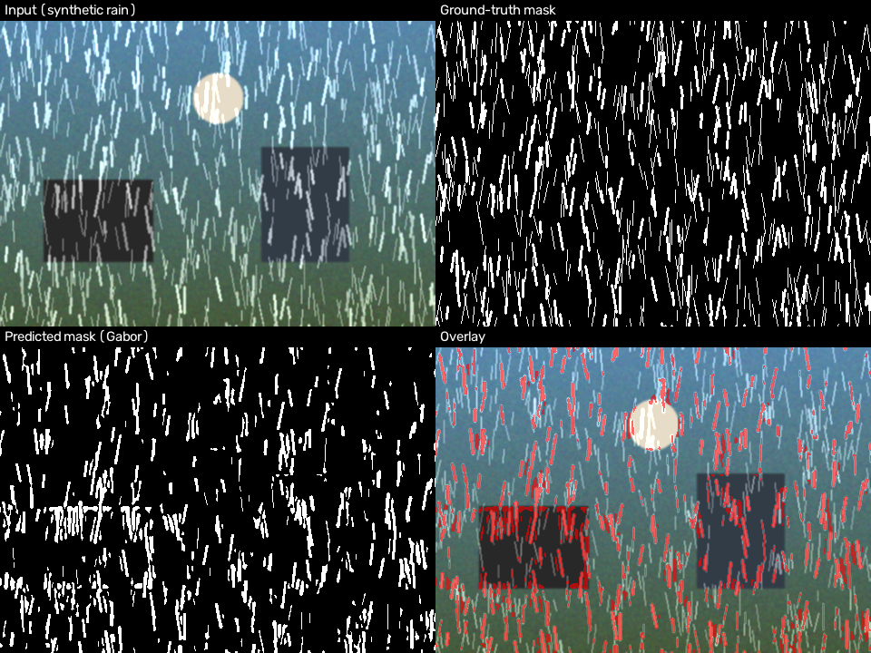
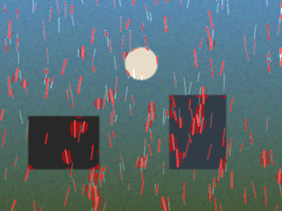

# Rain Streak Detection with Gabor Filters

**Course project — EE5175 Image Signal Processing (IPCV Lab), March 2025**

A traditional (non-deep-learning) computer vision pipeline for detecting rain
streaks in a single image and producing a binary rain mask, built around a
bank of oriented **Gabor filters**.

## Problem statement

Rain streaks in images degrade visibility and affect the performance of
vision applications such as autonomous driving, surveillance and remote
sensing. Detecting rain in a single image without deep learning is
challenging: the goal here is a robust, classical image-processing algorithm
that

- detects rain streaks in a single rainy image and produces the corresponding **rain mask**, and
- keeps **false detections low** across varying lighting and scene conditions,

evaluated quantitatively against ground-truth masks using **Intersection over
Union (IoU)**.

## Approach: Gabor-filter-bank rain streak detection

Rain streaks are thin, elongated, roughly-vertical structures. A Gabor filter
bank is a natural classical tool for this: each kernel is tuned to a specific
orientation and spatial frequency, so streaks that match one of the "near
vertical" kernels respond strongly while isotropic scene texture does not.

The pipeline (`src/gabor_rain_detector.py`) has four stages:

1. **High-frequency detail extraction.** The image is grayscaled and a
   large-kernel median filter estimates a smooth "base" layer (the scene
   without rain). Subtracting it from the grayscale image isolates a
   high-frequency **detail layer** containing rain streaks plus other
   high-frequency content (edges, texture).

2. **Oriented Gabor filter bank.** A bank of Gabor kernels spanning a small
   angular range around vertical (rain rarely falls perfectly straight down)
   and several wavelengths (to cover different streak widths/densities) is
   convolved with the detail layer. The per-pixel **maximum response** across
   the bank gives a streak-likelihood map — pixels aligned with any
   near-vertical kernel light up, isotropic noise/texture does not.

3. **Chroma suppression.** Rain streaks are close to achromatic (low
   saturation), being formed by scattered light. The likelihood map is
   down-weighted wherever the pixel is strongly saturated, suppressing
   colourful texture edges (foliage, painted surfaces, ...) that might
   otherwise pass the orientation filter.

4. **Thresholding + shape cleanup.** The weighted map is binarised with
   Otsu's method, cleaned with morphology, and passed through a
   connected-component filter that discards blobs which are neither thin nor
   near-vertical — removing residual false positives from scene edges that
   happen to share the streaks' dominant orientation.

Output: a binary rain mask, same resolution as the input image.

See the module docstring in [`src/gabor_rain_detector.py`](src/gabor_rain_detector.py)
for the full detail, and [`GaborRainDetectorConfig`](src/gabor_rain_detector.py)
for every tunable hyperparameter (kernel size, orientation spread, wavelengths,
morphology, shape filter thresholds, ...).

## Repository layout

```
├── src/
│   ├── gabor_rain_detector.py   # core detection pipeline + config
│   ├── metrics.py                # IoU, precision/recall/F1
│   └── utils.py                  # I/O, mask overlay helpers
├── scripts/
│   ├── detect.py                  # run detection on an image / folder
│   ├── evaluate.py                # run + score against a validation set (IoU)
│   └── generate_synthetic_demo.py # self-contained synthetic sanity check
├── data/                # place the course-provided datasets here (see data/README.md)
├── results/             # detection outputs get written here
└── assets/demo/         # committed example outputs (see below)
```

## Setup

```bash
pip install -r requirements.txt
```

Requires only NumPy and OpenCV.

## Usage

### 1. Detect rain streaks in images

```bash
python scripts/detect.py --input data/raw --output results/raw --overlay
```

Accepts a single image path or a directory. Writes `<name>_mask.png` (binary
rain mask) for each image, and optionally `<name>_overlay.png` /
`<name>_response.png`.

### 2. Evaluate against a validation set (IoU)

```bash
python scripts/evaluate.py \
    --images data/validation/images \
    --gt-masks data/validation/gt_masks \
    --output results/validation
```

Prints per-image IoU / Precision / Recall / F1 and the mean IoU across the
set, and (with `--output`) saves predicted masks, overlays and a
`metrics.csv`.

See [`data/README.md`](data/README.md) for how to obtain and place the
assignment's "Single Rain Images" and "Validation set" data — they are not
committed to this repository.

### 3. Self-contained demo (no download required)

Since the real datasets aren't bundled with the repo, a synthetic demo lets
you exercise the full pipeline immediately:

```bash
python scripts/generate_synthetic_demo.py --output data/synthetic_demo
python scripts/evaluate.py \
    --images data/synthetic_demo/images \
    --gt-masks data/synthetic_demo/gt_masks \
    --output results/synthetic_demo
```

This procedurally renders a scene with drawn-on rain streaks and an exact
ground-truth mask, then scores the detector against it — a smoke test, not a
substitute for evaluating on the real course data.

## Example result (synthetic demo)



*Top-left: synthetic rainy input. Top-right: ground-truth rain mask used to
draw it. Bottom-left: predicted mask from the Gabor pipeline. Bottom-right:
predicted mask overlaid on the input in red.*

| Image | IoU | Precision | Recall | F1 |
|---|---|---|---|---|
| `synthetic_rain_01` (dense rain) | 0.498 | 0.724 | 0.615 | 0.665 |
| `synthetic_rain_02` (light rain) | 0.479 | 0.526 | 0.841 | 0.647 |

A second, lighter-rain example:



These numbers are from the bundled synthetic sanity check only (regenerate
with the commands above); real-world IoU on the course validation set should
be reported separately once that data is downloaded, and the
`GaborRainDetectorConfig` hyperparameters may need re-tuning for it.

## Notes on false-positive control

The assignment specifically calls out minimizing false detections across
lighting/scene conditions. Three mechanisms in this pipeline target that:

- Restricting the Gabor bank to a **narrow angular band around vertical**
  (configurable via `orientation_spread_deg`) rather than all orientations.
- **Saturation-based down-weighting**, since rain streaks are close to
  achromatic but many false-positive textures (foliage, signage, etc.) are
  not.
- A **post-hoc shape filter** on connected components (elongation +
  orientation), which removes compact or off-axis blobs that pass
  thresholding but aren't shaped like rain streaks.

## License

MIT — see [LICENSE](LICENSE).
